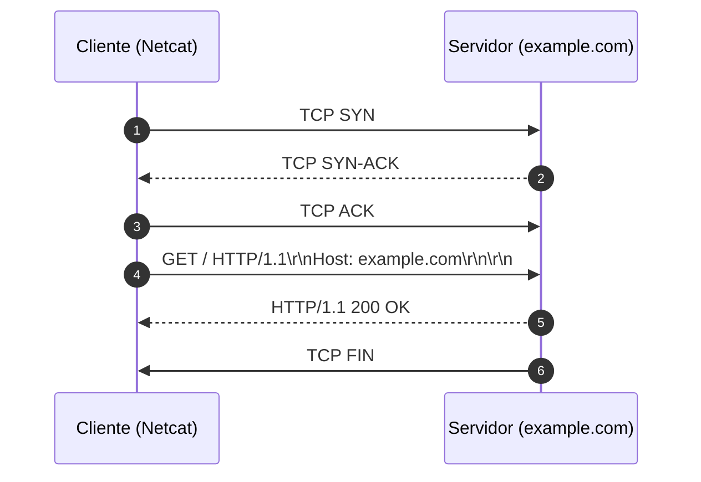

# Memória de Desenvolvimento — Semana 01
**Aluno:** Daniel Carvalho Gonçalves
**Curso:** Engenharia da Computação  

---

## 1. Mapeamento da Camada de Transporte
Diagrama Mermaid demonstrando o ciclo de vida da requisição executada no laboratório:

---
## 2. Captura Bruta e Análise do Protocolo
* **Comando Utilizado:** `nc -C example.com 80`
* **Status Line Retornada:** `HTTP/1.1 200 OK`

### Análise dos Headers Recebidos:
1. **`Content-Type`:** O MIME type: Declara que o conteúdo enviado é um documento HTML e que os caracteres usam a codificação UTF-8 (permitindo acentos e caracteres especiais).
Importância para o parser: Diz ao cliente (como o navegador) como interpretar os bytes recebidos. Sem isso, o navegador não sabe se deve renderizar uma página web, exibir texto puro ou baixar um arquivo PDF/imagem.
2. **`Content-Length`:** Delimitação do payload: Como a conexão TCP é um fluxo contínuo de bytes (stream), o cliente não sabe onde a resposta termina. O Content-Length especifica o tamanho exato do corpo da mensagem em bytes.
Funcionamento: O cliente lê a stream TCP até atingir essa quantidade exata de bytes e sabe que a resposta acabou (diferente do Transfer-Encoding: chunked, que usa blocos de tamanho dinâmico).
3. **`Connection: close`:** Connection: close: Instruí o servidor (ou cliente) a encerrar o socket TCP logo após o envio do último byte da resposta. Cada nova requisição exigirá uma nova conexão TCP (com novo handshake).

keep-alive: Mantém o socket TCP aberto para reuso. O cliente pode enviar várias requisições consecutivas (imagens, CSS, JS) pela mesma conexão, reduzindo drasticamente a latência e a carga no servidor.

---

## 3. Conclusão Técnica
Compreender o HTTP como um fluxo contínuo de bytes ASCII delimitado por sequências CRLF (\r\n), em vez de um arquivo estático, é fundamental porque a comunicação em rede ocorre sobre conexões TCP em stream, onde não existem fronteiras nativas entre mensagens. Ao enxergar o protocolo sob essa ótica de transmissão bruta de texto, o desenvolvedor compreende a real mecânica de requisição e resposta — percebendo que cabeçalhos e payloads dinâmicos são interpretados em tempo real através de delimitadores (\r\n para separar linhas e \r\n\r\n para marcar o fim dos cabeçalhos). Essa perspectiva desmistifica o funcionamento de clientes e servidores web, capacita a depuração de falhas no nível do socket (como cabeçalhos malformados ou conexões pendentes) e habilita a implementação correta de recursos avançados do protocolo, como chunked encoding, keep-alive e pipelining.
